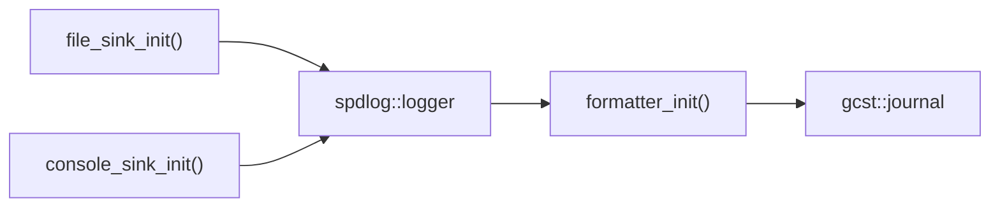

# Logging

<sub>[README](../README.md) · [Architecture](architecture.md) · [Building](build.md) · [Presets](presets.md) · [Local presets](local-presets.md) · [Dependencies](dependencies.md) · [CMake modules](cmake.md) · [CI](ci.md) · [Updating](updating.md) · [Scripting](scripting.md) · [Settings](settings.md) · [Logging](logging.md)</sub>

`gcst::logger`, part of the `gcst::utils` library, writes an application's log to a file and to the console through [spdlog](https://github.com/gabime/spdlog). The log file's location and the level of each output come from the [settings](settings.md), so the logger is initialized after them. Applications that need other outputs or formats extend it by inheritance.

- [Quick start](#quick-start)
- [Where records go](#where-records-go)
- [Logging macros](#logging-macros)
- [Errors](#errors)
- [Customizing the logger](#customizing-the-logger)
- [Reference](#reference)
- [Samples](#samples)

## Quick start

```cpp
#include <gcst/gcst.h>

int main(int argc, char** argv)
{
    if (auto r = gcst::init(argc, argv); !r)
        return r.error();

    INFO("Logging to {}", gcst::journal->filepath().string());
}
```

```cmake
target_link_libraries(my_app PRIVATE gcst::utils)
```

`gcst::init()` initializes the settings and then the logger. To initialize them separately — with [settings of your own](settings.md#adding-settings-of-your-own), say — call the two in this order:

```cpp
if (auto r = mysettings::init(argc, argv); !r)
    return r.error();

if (auto r = gcst::logger::init(); !r)
    return r.error();
```

## Where records go

| | File | Console |
|---|---|---|
| Destination | `<logdir-path>/<logfile-name>`, appended to | standard error, levels in color |
| Level | `file-loglevel`, `info` by default | `console-loglevel`, `info` by default |
| Options | `--logdir-path`, `--logfile-name`, `--file-loglevel` | `--console-loglevel` |

The options are [built-in settings](settings.md#built-in-settings). `logdir-path` defaults to `logs/` next to the executable, `logfile-name` to the start time, such as `2026-10-20_03-48-49.gcstlog`. `logfile-name` is never written to the config file, so every run starts a new file. To keep writing to one file, give `--logfile-name` or put `logfile-name` into the config file by hand.

Both outputs use the same pattern — date and time with microseconds, the level, the source file and line, the message:

```
[20.10.2026 03:48:49.823389]  info      main.cpp:7      Logging to /home/user/my-project/bin/logs/2026-10-20_03-48-49.gcstlog
```

Every record is flushed at once, so the file is complete even if the program crashes. The logger is made spdlog's default logger, so `spdlog::info()` and the other spdlog functions write to the same file and console.

## Logging macros

| Macro | Level |
|---|---|
| `TRACE(...)` | `trace` |
| `DEBUG(...)` | `debug` |
| `INFO(...)` | `info` |
| `WARN(...)` | `warn` |
| `ERROR(...)` | `error` |
| `CRITICAL(...)` | `critical` |

They take a [fmt](https://fmt.dev) format string and its arguments, like `spdlog::info()`, and record the file and line they are called from. Until the logger is initialized they do nothing, so code that logs can run before `init()` or without it.

```cpp
WARN("Port {} is busy, trying {}", port, port + 1);
```

Every level is compiled in: `gcst::utils` defines `SPDLOG_ACTIVE_LEVEL=SPDLOG_LEVEL_TRACE` for the targets linking it. Which records appear is decided at run time by the two log level settings.

> **[!NOTE]**  
> The macros come with `<gcst/gcst.h>` and `<gcst/utils.h>`. In a file that includes either of them, an identifier or an `#ifdef` named `DEBUG`, `ERROR` and so on refers to the macro.

## Errors

`gcst::logger::init()` returns `gcst::etype`. `gcst::journal` is assigned only on success.

| Code | Cause |
|---|---|
| `1` | the settings aren't initialized |
| `2` | `logfile-name` is missing or empty |
| `3` | `logdir-path` is missing or empty |
| `4` | `setup()` failed: an output or the format couldn't be set up |

`gcst::init()` returns `1` when the settings fail and `2` when the logger does.

## Customizing the logger

Derive from `gcst::basic_logger`, passing your class as the template argument, and override the steps you want to change. `init()` creates your class and calls `setup()`, which builds the logger out of those steps:



`setup()` creates both sinks, combines them into one `spdlog::logger` that passes every level on and flushes every record, applies `formatter_init()` and makes the result spdlog's default logger. The sinks filter by their own levels.

This one writes to a rotating file and gives the console a short pattern:

```cpp
// mylogger.h
#include <gcst/gcst.h>

class mylogger : public gcst::basic_logger <mylogger>
{
    protected:
        using basic_logger::basic_logger;

        spdlog::sink_ptr console;

        gcst::etype formatter_init() override;
        std::expected <spdlog::sink_ptr, int> file_sink_init() override;
        std::expected <spdlog::sink_ptr, int> console_sink_init() override;
};
```

```cpp
// mylogger.cpp
#include "mylogger.h"
#include <spdlog/sinks/rotating_file_sink.h>

std::expected <spdlog::sink_ptr, int> mylogger::file_sink_init()
{
    auto level = gcst::params->get("file-loglevel");
    if (!level)
        return std::unexpected(level.error());

    // up to 3 files of 1 MiB
    auto sink = std::make_shared <spdlog::sinks::rotating_file_sink_mt> (this->filepath().string(), 1024 * 1024, 3);
    sink->set_level(spdlog::level::from_str(std::string(*level)));
    return sink;
}

std::expected <spdlog::sink_ptr, int> mylogger::console_sink_init()
{
    auto sink = ilogger::console_sink_init();      // the built-in one, leveled by console-loglevel
    if (sink)
        this->console = *sink;
    return sink;
}

gcst::etype mylogger::formatter_init()
{
    if (auto r = ilogger::formatter_init(); !r)    // the detailed pattern, on every sink
        return r;

    this->console->set_pattern("%^%-8l%$ %v");     // then a short one on the console
    return 0;
}
```

```cpp
// main.cpp
if (auto r = gcst::settings::init(argc, argv); !r)
    return r.error();

if (auto r = mylogger::init(); !r)
    return r.error();
```

Rules for a derived class:

- **Inherit publicly** from `gcst::basic_logger<YourClass>`. The template argument tells `init()` which class to create; `gcst::logger` is simply `basic_logger<>` with nothing overridden.
- **Keep constructors `protected`, not `private`,** for the same reason as with [settings](settings.md#adding-settings-of-your-own): `init()` creates the object through a helper class derived from yours. `using basic_logger::basic_logger;` is enough.
- **Initialize the settings first.** `init()` takes the file path from them, and the built-in sinks take their levels.
- **Set per-sink patterns after `ilogger::formatter_init()`.** It runs once both sinks exist and sets its pattern on every one of them.
- **Include the spdlog headers** of the sinks you use. `gcst::utils` passes spdlog on to the targets linking it, so no extra CMake is needed.

## Reference

Names are declared in `gcst::utils`; `logger`, `basic_logger`, `journal` and `init` are also available in `gcst`.

| Name | Description |
|---|---|
| `ilogger` | Abstract base with the interface below |
| `basic_logger<D = void>` | Class template that adds `static etype init()` — see [Errors](#errors). Derive from it to customize the logger |
| `logger` | `basic_logger<>`: the built-in logger |
| `journal` | `std::unique_ptr<ilogger>` holding the logger after a successful `init()` |
| `init(argc, argv[, cli])` | Initializes the [settings](settings.md), passing the arguments on, then the logger |
| `GCST_LOGGER_INITED` | Macro, true once the logger is initialized |

Public members of `ilogger`:

| Member | Description |
|---|---|
| `std::shared_ptr<spdlog::logger> logger` | The spdlog logger |
| `const fs::path& filepath() const` | The log file path |

Protected members, available to derived classes:

| Member | Description |
|---|---|
| `fs::path _filepath` | The log file path, `<logdir-path>/<logfile-name>` |
| `virtual etype setup()` | Builds the logger from the steps below and makes it spdlog's default logger |
| `virtual std::expected<spdlog::sink_ptr, int> file_sink_init()` | Creates the file sink |
| `virtual std::expected<spdlog::sink_ptr, int> console_sink_init()` | Creates the console sink |
| `virtual etype formatter_init()` | Sets the pattern on the logger and all its sinks |

## Samples

`samples/` holds two logger programs next to the [settings samples](settings.md#samples), built unless [`GCST_SAMPLES_BUILD`](build.md#samples) turns them off:

| Directory | Executable | Shows |
|---|---|---|
| `samples/basic_logger/` | `bin/samples.BasicLogger` | `gcst::init()` and every macro |
| `samples/mylogger/` | `bin/samples.Mylogger` | A derived class with a rotating file and a short console pattern |

`bin/samples.BasicLogger --console-loglevel trace` shows every level on the console.
